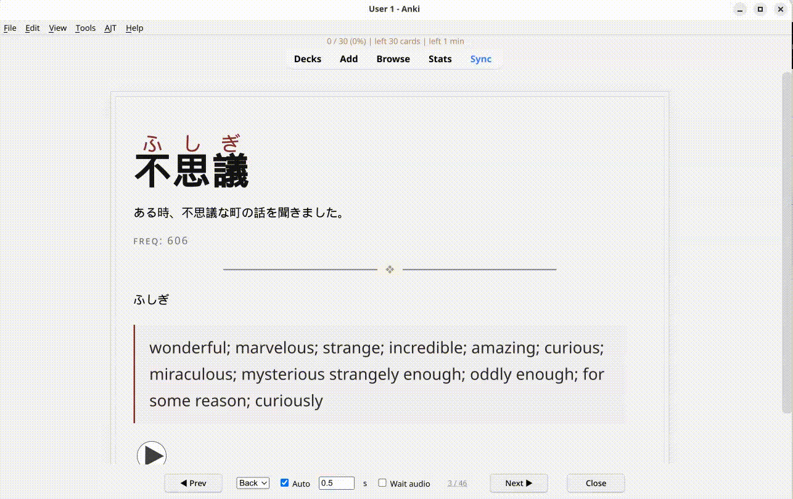

# Lightspeed

Browse your Anki deck without the pressure of grading. Just flip through cards at your own speed.

I kept wanting a way to quickly go through cards I've already seen, like skimming through notes before an exam. Anki's reviewer is great for spaced repetition, but sometimes you just want to look at your cards. So I made this.

## Features

- **Prev / Next navigation** instead of Again / Hard / Good / Easy
- Cards look exactly like normal reviews (same templates, styling, audio)
- Auto-advance with adjustable speed (0.1s to 30s)
- Remembers where you stopped, picks up from there next time
- Click the progress counter to jump to any card
- Keyboard friendly, arrow keys to navigate, Escape to close

## Install

Copy or symlink `lightspeed/` into your Anki addons folder and restart Anki. Open any deck and you'll see **Lightspeed** in the bottom row next to Options.

## Usage

| | |
|---|---|
| `Ctrl+Shift+L` | Launch from deck overview |
| `←` `→` | Previous / Next card |
| `Escape` | Close |
| Front / Back | Toggle which side to show |
| Auto | Scroll through cards on a timer |
| Wait audio | Hold auto-advance until audio finishes playing |

## Requirements

Anki 2.1.50 or newer.

## Contributing

Feel free to open issues or PRs. Keep the code short and readable.

## License

GPL-3.0
